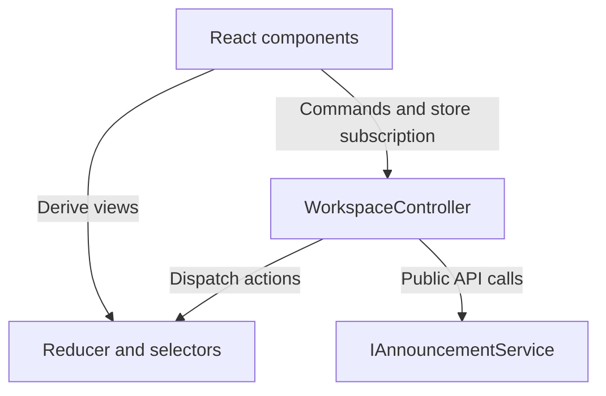

# Announcement Publishing Workspace

A React + TypeScript workspace for a communications team. Users select one of three prepared announcements, publish it
through the supplied (simulated) publishing service, and follow the result until the service confirms an outcome.

The focus is correctness under unreliable communication: lost responses, failing status reads, out-of-order responses,
concurrent publications, page refreshes and resets. The supplied mock service in `src/mocks` is used **unchanged** and is
the only source of publication truth.

## Features

- Announcement list and details; titles and content come from `getAnnouncements()`.
- Publish an announcement and publish others while earlier operations are still unresolved.
- Clear, per-announcement states: **Not submitted**, **Sending request**, **Processing**, **Published**, **Rejected**,
  **Outcome unconfirmed** (a communication problem, never a rejection), and, while history is not yet known,
  **Restoring history** / **History unavailable**.
- **Check status** for unresolved attempts, and **Resend publish request** when the service has not confirmed the operation
  after a lost or unknown response (same operation ID).
- Per-announcement attempt history; rejected attempts stay visible after a new attempt.
- Recovery after refresh through `listOperations()`; new attempts are blocked until recovery succeeds.
- **Automatic updates** switch (on by default): follows unresolved operations and retries failed loading with backoff.
- **Simulation settings** (developer tools): scenario selector and **Reset workspace** with a confirmation dialog.
- Responsive from 320 px, keyboard accessible, visible focus, polite screen-reader announcements, reduced-motion support.

## Requirements

- **Node.js** `^22.22.2 || ^24.15.0 || >=26.0.0` (declared in `package.json` `engines`; `.nvmrc` pins `22.22.2`).
  These ranges come from the locked test dependencies (`jsdom@31` and `undici@8`); older Node versions are not supported.
- npm (bundled with Node).
- For end-to-end tests: a Chromium browser installed by Playwright.

## Getting started

With nvm, install and select the version pinned in `.nvmrc`:

```bash
nvm install
nvm use
```

Any Node.js installation matching the supported range works. Install dependencies and start the development server:

```bash
npm ci             # install exactly the locked dependencies
npm run dev        # development server (Vite prints the local URL)
```

Production build:

```bash
npm run build      # typecheck + production build into dist/
npm run preview    # serve the production build locally
```

The app needs normal browser session storage: the mock service keeps its records there.

## Checks

| Command | What it runs |
| --- | --- |
| `npm run typecheck` | TypeScript (`tsc --noEmit`, strict) |
| `npm run lint` | ESLint, zero warnings allowed (`src/mocks` is excluded to preserve the supplied files) |
| `npm run format:check` | Prettier check (`npm run format` writes); `src/mocks` and Markdown are excluded |
| `npm test` | Unit, integration and UI tests (Vitest + Testing Library, jsdom, fake timers) |
| `npm run test:coverage` | The same with a V8 coverage report |
| `npm run check` | typecheck + lint + format check + tests + build |
| `npm run test:e2e` | Playwright end-to-end tests; builds the app and serves it on port 4173 |

Install Chromium for the project's Playwright version, then run the end-to-end tests:

```bash
npx playwright install chromium
npm run test:e2e
```

To use an already installed Chromium instead, set `PW_CHROMIUM_PATH=/path/to/chromium`.

If Playwright reports `Executable doesn't exist`, run the following from the project root to reinstall its headless browser:

```bash
npx playwright install chromium --only-shell --force
```

Wait for the installation to complete successfully before rerunning `npm run test:e2e`.

## Architecture



Components read the controller's external store with `useSyncExternalStore`, invoke its commands, and use domain selectors
to derive views. The controller owns asynchronous service work, timers, retries and reset; the domain contains pure state
transitions and derived rules. The supplied service is accessed through its public API.

```
src/
  main.tsx                    entry point: creates the service, renders <App/> in StrictMode
  App.tsx                     composition: controller lifecycle, browser availability events, selection, layout
  styles.css                  Tailwind import and design tokens (@theme)
  mocks/                      supplied service, unchanged
  domain/                     pure rules (no React, no I/O)
    types.ts                  WorkspaceState, OperationRecord, Issue
    workspaceReducer.ts       state transitions, including request-ordered feedback (withFeedback)
    selectors.ts              recovery-aware views, summary counts, canStartAttempt / canResend / canCheck
    snapshot.ts               decideSnapshot: which service snapshot wins
    errors.ts                 isDefinitiveRefusal
    operationId.ts            createOperationId, isValidId
  controller/
    workspaceController.ts    publish, resend, status checks, loading, reset, automatic scheduling
    serviceErrors.ts          service-adapter boundary: maps thrown errors to domain issues
  components/
    publication/              PublicationPanel, PublicationStatusCard, PublicationActions, IssueNotice
    history/                  OperationHistory, OperationHistoryItem
    simulation/               SimulationSettings, ScenarioSelector, ResetWorkspaceControl, ResetDialog
    ui/                       shared building blocks: primitives (Button, Alert…), Icon, tones
    AnnouncementList, AnnouncementDetails, AutomaticUpdatesControl, WorkspaceHeader, StatusBadge,
    StatusAnnouncer (+ statusSignals.ts), format.ts (labels, issue messages and time formatting)
  test/                       test setup, fixtures, fake-timer helpers
e2e/                          Playwright workflows
```

Components depend on the controller and domain; the controller depends on the domain and service. The domain uses the
service contract types but does not call the service or import its implementation, React, or the controller.

## Technical decisions

- **External store + pure reducer + one controller** (no Redux, Context or data-fetching library). The controller records a
  new attempt synchronously before any network call, so a second click in the same tick already sees it. React effects
  manage the controller lifecycle through `start()`/`stop()`; synchronous guards and in-flight request deduplication prevent
  duplicate work under StrictMode. All async service logic is testable without React.
- **One record per attempt with three separate parts:** the service *fact* (`snapshot`), the lifecycle of the *publish
  request* (`sending | accepted | unconfirmed | refused`), and the latest *request problem* (`issue`). "Outcome unconfirmed"
  is derived, never stored.
- **Operations live in a `Map`.** Any nonblank string is a valid operation ID, including `constructor`, `toString` and
  `__proto__`, which a plain object would confuse with `Object.prototype` members.
- **Facts are ordered by version, feedback by request.** Snapshot versions order service facts (1 = processing, 2 = terminal);
  a terminal outcome never goes back. Client request numbers order feedback while the outcome is unresolved: an older
  response cannot overwrite a newer request's issue, and a newer successful check can clear an earlier error even when the
  snapshot version is unchanged. A valid terminal outcome takes precedence over communication issues and clears them,
  even when returned by an earlier-started request.
- **Representative attempt:** an announcement shows its published attempt if any, otherwise its newest unresolved attempt,
  otherwise its newest rejected one. In-session attempts are ordered by an insertion counter. After refresh, counters are
  reconstructed from the service's `createdAt` values, preserving list order for ties.
- **Conservative error handling.** Only the service's documented refusals (`OPERATION_ID_CONFLICT`,
  `UNKNOWN_ANNOUNCEMENT`) and the client's own ID validation (done before sending) establish that the request created no new
  operation. Any other failure — including a generic `TypeError` or `RangeError` — leaves the attempt recoverable with its
  original operation ID.
- **Tailwind CSS with central design tokens.** Theme values are defined once in `src/styles.css`; components use utilities.
  Runtime dependencies are only `react` and `react-dom`.

## Recovery and idempotency

- **Operation IDs.** One ID per logical attempt (`op-` + UUID), created and recorded before the request is sent.
  A subsequent attempt gets a new ID only after a confirmed rejection or a definitive refusal establishing that the
  previous request created no new operation. Communication failures are recovered with the original ID.
- **Lost or unknown responses.** The attempt becomes *Outcome unconfirmed*. *Check status* reads `getStatus(id)`;
  *Resend publish request* calls `publish(announcementId, sameId)`, which the service treats as the same operation.
  A `null` status means "not recorded", which is neither a rejection nor permission to start a new attempt.
- **Refresh.** The app does not persist its own workspace state. `listOperations()` rebuilds attempts from the mock service's
  stored records, and unresolved ones are followed again. Until recovery succeeds, announcements without known attempts
  show *Restoring history* / *History unavailable* rather than *Not submitted*. Known outcomes are retained, counters show
  "—", and new attempts are blocked in both the UI and the controller. *Retry loading* is available after a loading or
  recovery failure.
- **Confirmed results are final.** A communication error never turns *Published* or *Rejected* into anything else.
- **Reset workspace** (developer tool) asks for confirmation, then calls the public `service.reset()`. If that throws,
  nothing changes locally. Otherwise the controller increments an *epoch*, clears timers and in-flight bookkeeping, and
  reloads through the public API. Every service call remembers its starting epoch, so responses, errors and cleanup from
  before the reset are ignored, even if an operation ID is reused. The Automatic updates preference is kept.
- **Automatic updates** run only while the switch is on, the tab is visible and the browser is online. Background work only
  reads status (never publishes or resends) and keeps at most one timer per operation:
  - while an operation is healthy but unfinished, its next status check is scheduled **1.5 s** after the previous one
    settles (and 1.5 s after a new publish request starts);
  - after consecutive failed checks of that operation, the delay backs off to 1 s, 2 s, 4 s, 8 s and then stays at
    **15 s** until a check succeeds, which returns it to the 1.5 s rhythm;
  - failed loading/recovery of the workspace is retried with the same 1 s … 15 s backoff.

  These delays are per operation and are measured from when a check settles, so they are not a global request-rate limit:
  several unresolved operations are checked independently, and manual *Check status* is never delayed (it shares an
  in-flight check instead of starting a second one). Checks stop at terminal outcomes, and when automatic work becomes
  possible again each unresolved operation gets one prompt check. Becoming visible or online never turns a switch on that
  the user turned off.

## Simulation scenarios

All six supplied scenarios are covered by automated tests and can be selected under **Simulation settings**:
`success`, `explicit-rejection`, `lost-response`, `status-check-failure`, `overlapping`, `slow-response`.
A scenario applies to new operations only.

## Testing

- Domain rules are tested as pure functions.
- The controller is tested against the real mock service with Vitest fake timers (all six scenarios, refresh recovery,
  automatic updates), and with a controlled fake service whose responses the test resolves in any order (request ordering,
  reset boundaries, error classification).
- UI tests render the app in StrictMode with Testing Library (states, dialog focus handling, live-region announcements).
- Playwright runs the main workflows in Chromium against a production build.

## Assumptions

- Each announcement needs one successful publication. After a previous attempt, a new one is allowed only after a confirmed
  rejection or a definitive refusal establishing that the previous request created no new operation.
- While recovery has failed, announcements can still be browsed, but no new attempt can start.
- Selection and the Automatic updates preference are view state and are not restored after refresh.
- Reset is a developer tool and is only offered under Simulation settings.

## Known limitations

- The app does not persist its own pending operation IDs. Recovery relies on the supplied service recording operations
  synchronously when `publish()` is called, so `listOperations()` can rediscover them after refresh. Supporting a backend
  that can accept a request without making the operation discoverable during recovery would require durable pending
  operation IDs or another recovery mechanism.
- With Automatic updates on, an unresolved operation is followed until its outcome is known, with no upper limit on the
  number of checks (a 1.5 s delay after healthy checks; failure retries back off up to 15 s).
- Live-region behavior was verified at the DOM level, including repeated identical text and combined outcomes for
  independent announcements; it was not tested with a real screen reader.
- A failed `listOperations()` blocks new attempts for all announcements, because the list cannot be narrowed to one.
- Cross-tab and cross-device coordination is out of scope.
- End-to-end tests run in Chromium only.
